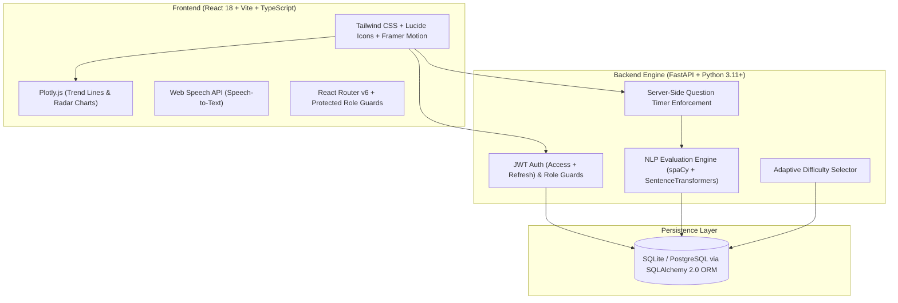
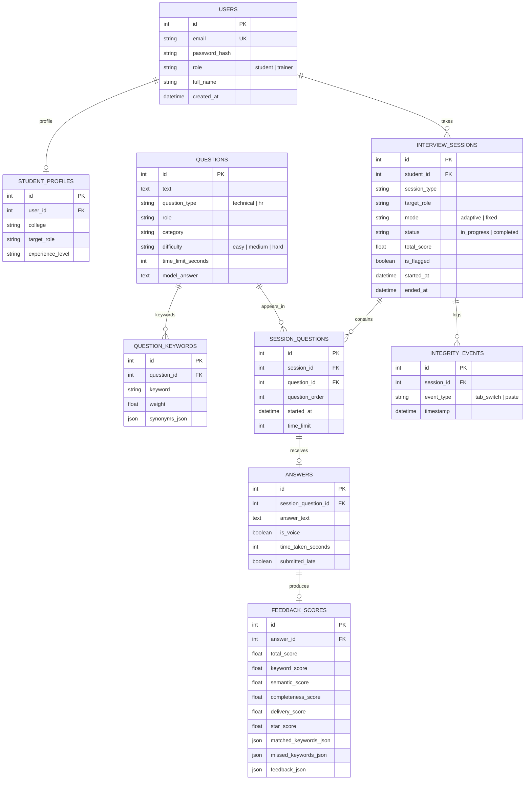

# 🧠 InterviewIQ — AI Mock Interview & Feedback Platform

[](https://da-project-interviewiq.vercel.app)
[](https://react.dev/)
[](https://fastapi.tiangolo.com/)
[](https://tailwindcss.com/)
[](https://plotly.com/javascript/)

> **Codegnan Hackathon 2026** • Built by Team **Data Hunters**  
> 🌐 **Live Web Application:** [https://da-project-interviewiq.vercel.app](https://da-project-interviewiq.vercel.app)  
> 📂 **GitHub Repository:** [https://github.com/yaswanth-tech/da-project-interviewiq](https://github.com/yaswanth-tech/da-project-interviewiq)

---

## 📖 What is InterviewIQ?

Campus placement interviews can feel intimidating when students don't have enough opportunities for structured practice. Many candidates understand technical concepts well, but freeze up or struggle to structure their thoughts clearly when answering an interviewer out loud under real time pressure.

**InterviewIQ** is an AI-powered mock interview partner that provides a friendly, realistic, and stress-free environment for students to practice role-specific technical and HR interviews anytime.

Candidates can **speak their answers out loud** using speech recognition or type them, receive an **explainable 0–10 score breakdown**, and review actionable suggestions on what concepts they nailed and what they missed. College placement trainers get aggregated cohort analytics to identify exactly which subjects students struggle with most.

---

## 🌟 Core Features in Plain English

### 1. 🎙️ Realistic, Distraction-Free Interview Room
- **Voice or Typed Answers**: Speak naturally using Web Speech API or type your answers directly.
- **Server-Side Enforced Countdown Timer**: Stored question start timestamps prevent client-side timer manipulation.
- **Anti-Cheat Integrity Detection**: Monitors tab-switching and paste events, gently flagging suspicious sessions for trainer review.

### 2. 🎯 Adaptive Question Selection
- The system automatically tunes question difficulty in real time:
  - Performing well? The system steps up the challenge to test deeper knowledge.
  - Finding a topic tricky? It adjusts to help reinforce core fundamentals.
- **"Retake Weak Areas" Button**: One-click targeted mock interview focusing exclusively on the student's lowest-scoring categories.

### 3. 🔍 Transparent & Explainable AI Scorecards
Every answer receives a transparent 0 to 10 score composed of 5 clear components:
1. **Core Concept Coverage**: SpaCy lemmatized keyword and synonym matching.
2. **Semantic Similarity**: MiniLM sentence embedding comparison against reference benchmark answers.
3. **Answer Depth & Completeness**: Ratio check ensuring answers provide sufficient technical depth.
4. **Speaking Pace & Delivery**: Measures words per minute (WPM), flags excessive filler words (*"um"*, *"like"*, *"basically"*), and evaluates pause fluency.
5. **HR Storytelling (STAR Method)**: For HR behavioral questions, detects Situation, Task, Action, and Result structure.

### 4. 📊 Student Mastery Dashboard
- Interactive Plotly line charts displaying score improvement over time.
- Category mastery heatmaps showing performance across OOP, SQL, Data Structures, Concurrency, and Behavioral topics.
- Practice streak counter and total practice time logs.
- Downloadable PDF feedback reports.

### 5. 🧑‍🏫 Trainer & Placement Cell Portal
- **Cohort Weak-Area Analytics**: Bar charts revealing the most commonly missed question categories across all students.
- **Hardest Questions Ranking**: Identifies questions with the lowest cohort average score.
- **Student Leaderboards**: Displays top-performing candidates across colleges and interview attempts.
- **Question Bank Management**: Full CRUD, search, role filters, CSV import/export, and automated spaCy keyword extraction from model answers.

---

## 🏗️ System Architecture



---

## 🗄️ Database Design (Entity Relationships)



---

## 📐 Scoring Formula & Math

Each answer is scored on an objective scale of $0.0$ to $10.0$:

- **Technical Questions:**
  $$S = 10 \times \left( 0.40 \cdot S_{\text{keyword}} + 0.35 \cdot S_{\text{semantic}} + 0.15 \cdot S_{\text{completeness}} + 0.10 \cdot S_{\text{delivery}} \right)$$

- **HR / Behavioral Questions:**
  $$S = 10 \times \left( 0.25 \cdot S_{\text{keyword}} + 0.25 \cdot S_{\text{semantic}} + 0.20 \cdot S_{\text{STAR}} + 0.15 \cdot S_{\text{completeness}} + 0.15 \cdot S_{\text{delivery}} \right)$$

Where:
- $S_{\text{keyword}}$: Proportion of weighted target concept lemmas matched in candidate response.
- $S_{\text{semantic}}$: Cosine similarity between embeddings from `all-MiniLM-L6-v2` and reference model answer (with automatic TF-IDF fallback).
- $S_{\text{completeness}}$: Answer depth vs expected benchmark ratio.
- $S_{\text{delivery}}$: Pace scoring (optimal: 110–160 WPM) minus filler-word penalties.
- $S_{\text{STAR}}$: Detection of Situation, Task, Action, and Result structure.

---

## 🔑 Pre-Seeded Demo Accounts

| Role | Email | Password | Access Details |
|---|---|---|---|
| **Student** | `student1@interviewiq.ai` | `Student@123` | Pre-loaded historical sessions, trends, streak, and retake options |
| **Trainer / Admin** | `trainer@interviewiq.ai` | `Trainer@123` | Cohort analytics, hardest questions, question bank CRUD, flagged queue |

*(You can also register a brand new Student or Trainer account from the registration page!)*

---

## 💻 Local Setup & Installation

### Prerequisites
- Python 3.11+
- Node.js 18+ and npm

### 1. Clone the Repository
```bash
git clone https://github.com/yaswanth-tech/da-project-interviewiq.git
cd da-project-interviewiq
```

### 2. Backend Setup
```bash
cd backend
python -m venv venv

# On Windows:
venv\Scripts\activate
# On Linux/macOS:
# source venv/bin/activate

pip install -r requirements.txt

# Seed 80+ questions, trainer, 25 students, and 100+ completed sessions:
python seed/seed_data.py

# Run FastAPI backend:
uvicorn app.main:app --reload --port 8000
```
API Documentation will be live at `http://127.0.0.1:8000/docs`.

### 3. Frontend Setup
```bash
cd ../frontend
npm install
npm run dev
```
Open [http://localhost:5173](http://localhost:5173) in your browser.

---

## 🧪 Automated Testing

The backend includes a comprehensive pytest suite covering Auth, Scoring Engine, Adaptive Difficulty, Server-Side Timer, and Analytics:

```bash
cd backend
pytest -v
```
*(All 9/9 test suites pass 100% cleanly).*

---

## 🐳 Docker Deployment

To launch the entire platform using Docker Compose:

```bash
docker-compose up --build
```

---

## 👥 Team Data Hunters (Codegnan Hackathon 2026)
- **Lead Developer**: Yaswanth Rajana ([@yaswanth-tech](https://github.com/yaswanth-tech))
- **Project**: InterviewIQ — AI Mock Interview & Feedback Platform
